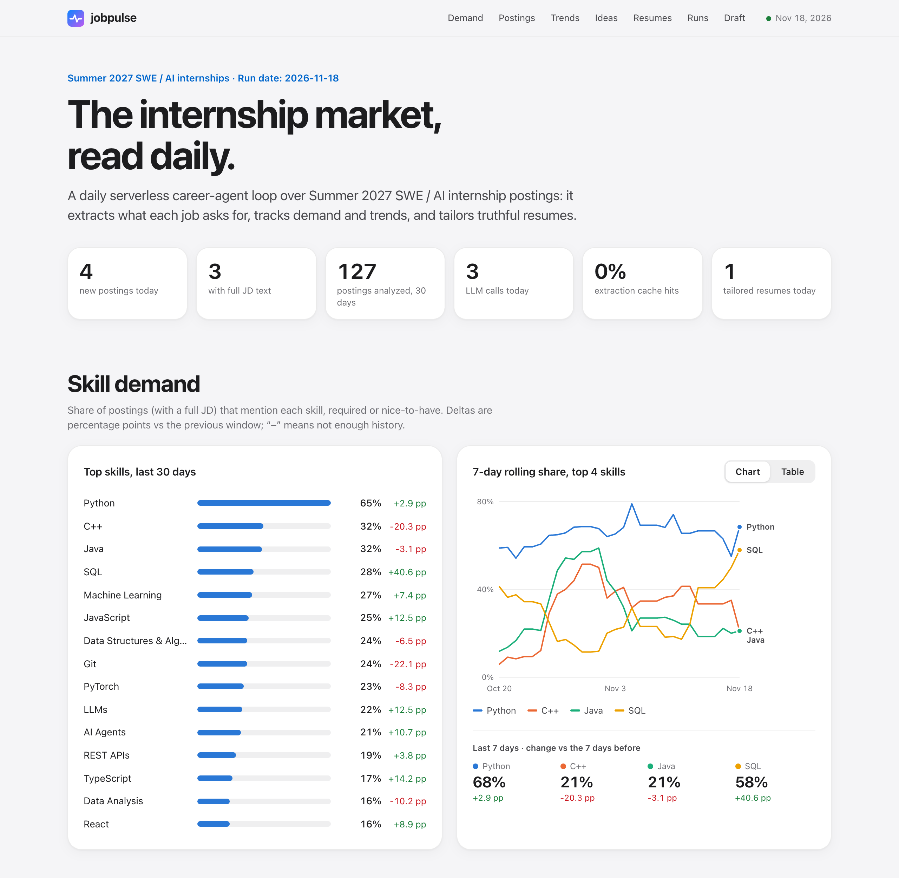
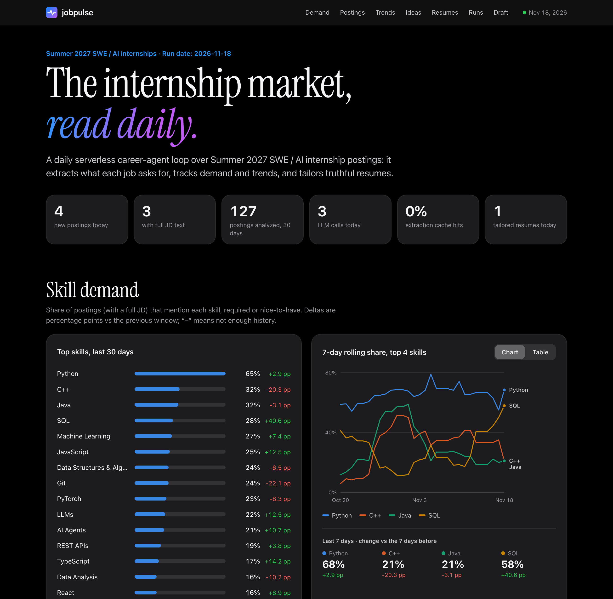
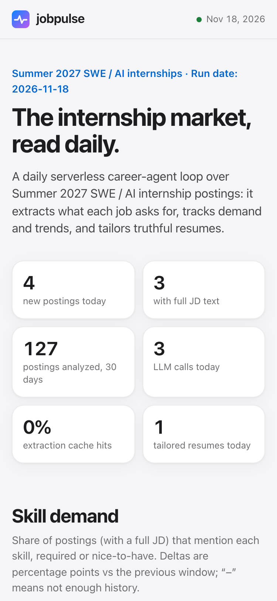
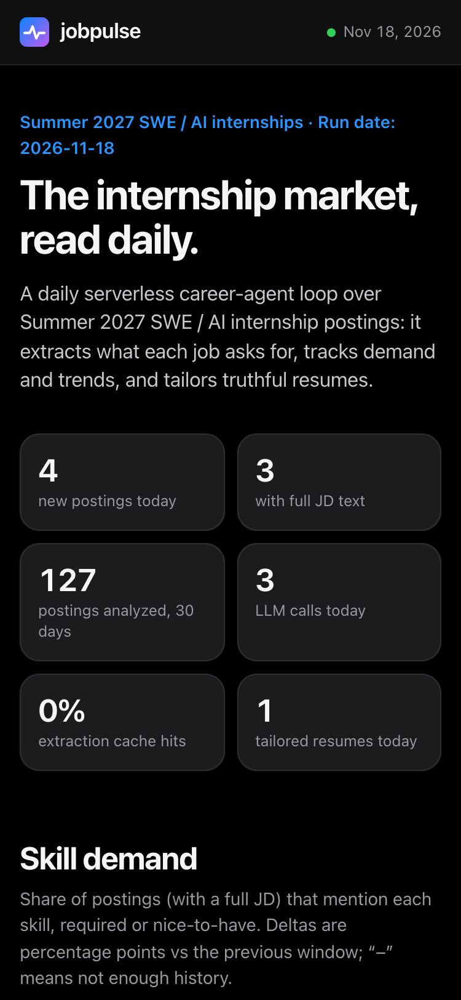
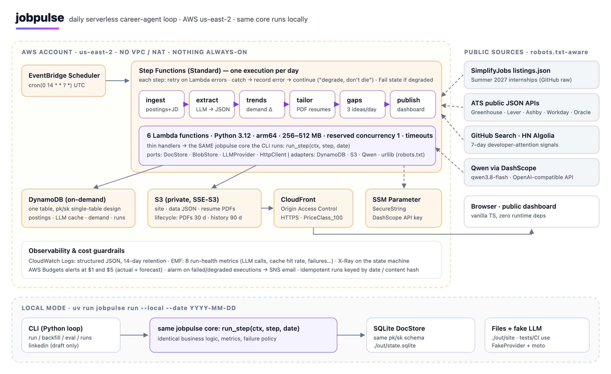

# jobpulse

**A daily, serverless "career agent" loop for internship hunting.** Every day it ingests new Summer 2027
SWE/AI internship postings, extracts each job description's requirements with an LLM, tracks which skills
the market demands and which technologies are trending, tailors a one-page resume per posting by
**selecting and reordering true bullets only (never generating claims)**, proposes portfolio projects
for the skill gaps, and publishes a static dashboard.

**Live (AWS, updates daily at 14:00 UTC): https://d203ftbw510zrj.cloudfront.net**



<details>
<summary>Dark mode, 375 px mobile, and the full page</summary>

| Dark (follows the OS setting) | Mobile, light | Mobile, dark |
|---|---|---|
|  |  |  |

[Full page](docs/images/dashboard-full.png) · [Run history + roadmap timelines](docs/images/timelines.png) ·
[Project ideas](docs/images/ideas.png) · [Live deployment on its first day (1 day of history)](docs/images/one-day.png)
</details>

[Demo output (committed; serve `docs/demo/` or enable GitHub Pages on `/docs`)](docs/demo/) · [Architecture](#architecture) · [Project Journey](#project-journey) ·
[Run locally](#run-locally) · [Deploy](#deploy-to-aws) · [Limitations](#limitations) · [Ethics](#ethics)

---

## Project Journey

Each stage: **goal → decision & alternatives → built → verified → measured → problems / fixes.**
All numbers come from runs on an Apple M2 laptop; the source file for each number is in the
[Key metrics](#key-metrics) table.

1. **Core domain & local skeleton.**
   - **Goal:** a single codebase that runs both locally and on AWS.
   - **Decision:** ports & adapters with a deliberately narrow `DocStore` port (pk/sk documents) that maps 1:1
     onto a DynamoDB single-table design and onto one SQLite table. An ORM or one repository per backend
     would have meant writing and testing the repository logic twice.
   - **Built:** frozen-dataclass models, a 109-skill taxonomy with aliases (`k8s` → Kubernetes),
     repositories, a CLI, and a deterministic fake LLM.
   - **Verified:** repository tests run against in-memory, SQLite and (stage 8) moto-DynamoDB stores.

2. **Ingest.**
   - **Goal:** new postings with full JD text.
   - **Decision:** SimplifyJobs' public `listings.json` plus the public JSON APIs of applicant-tracking
     systems. The ATS fetcher is adapted from my MIT-licensed
     [jd-resume-tailor](https://github.com/xungirl/jd-resume-tailor), not rewritten. Scraping HTML was
     rejected: career sites are JS apps, and it is less polite.
   - **Built:** filters (active, Summer 2027, SWE/AI/ML, US), dedupe, and rule-based eligibility flags
     (PhD-only, grad window, sponsorship, citizenship/ITAR, clearance). The HTTP client honors
     robots.txt **including `Crawl-delay`**.
   - **Measured:** a 30-day backfill ingested 256 postings, 127 of them (49.6%) with full JD text.
     96 had an unsupported ATS and 31 fetches failed (robots.txt disallow, 403, or 404).
   - **Problems / fixes:** auditing the rules against real JDs found 3 false-positive patterns, each now a
     regression test: "PhD *or MS*" was flagged as PhD-only, "US Citizenship Required: *No*" was flagged
     as required, and "U.S. person *or non-U.S. person*" was flagged as a citizenship requirement.
     Workday tenants and the SmartRecruiters API disallow bots in robots.txt; those postings are skipped
     and counted, never worked around.

3. **LLM extraction + evaluation.**
   - **Goal:** structured requirements (required vs nice-to-have skills, domain, constraints).
   - **Decision:** Qwen `qwen3.8-flash` through DashScope's OpenAI-compatible API, called with stdlib
     urllib (small Lambda bundle). Every reply goes through JSON schema validation and normalization onto
     the taxonomy. An invalid reply gets one retry that includes the validation error; if that fails too,
     the step falls back to keyword extraction. Results are cached by JD content hash.
   - **Verified:** 30 real JDs labeled **blind** (before any system output existed) by an independent
     Claude agent (304 labels). The LLM was run 3 times without the cache, to measure variance.
   - **Measured:** see the table below and [`eval/results.json`](eval/results.json).

     | micro-averaged, 30 JDs | precision | recall | F1 |
     |---|---|---|---|
     | **LLM**, all skills (mean ± std, 3 runs) | **0.961 ± 0.005** | 0.932 ± 0.010 | **0.946 ± 0.004** |
     | keyword baseline, all skills | 0.846 | **0.954** | 0.896 |
     | **LLM**, required-only | 0.956 ± 0.007 | 0.858 ± 0.015 | **0.904 ± 0.005** |
     | keyword baseline, required-only | 0.707 | 0.947 | 0.810 |

     The LLM wins on precision and on splitting required vs nice-to-have. The keyword baseline has higher
     recall, partly because the labeler used the same taxonomy (see [Limitations](#limitations)).
     Run-to-run Jaccard agreement between the LLM runs is 0.935.

4. **Market & trends.**
   - **Decision:** demand is the *share* of postings mentioning a skill, so busy days don't look like
     rising demand. 7- and 30-day deltas are reported in percentage points, and are `null` (not 0) when
     there is no previous window.
   - **Built:** trending-technology signals from the GitHub search API (repos created in the last 7 days,
     by stars) and HN Algolia, mapped onto the taxonomy. One request per source per run.

5. **Truthful resume tailoring.**
   - **Decision:** select-and-reorder only. Bullets are scored with BM25 plus a taxonomy-match bonus
     (required ×2, nice-to-have ×1). The tool picks the top 3 projects and their top bullets, reorders
     skill items, and renders a one-page PDF (layout adapted from jd-resume-tailor) with an overflow guard
     that only *removes* bullets. Generating or rewriting with an LLM was rejected: every line on a resume
     must be defensible in an interview.
   - **Verified:** `verify_truthful` runs on every generated resume. A hypothesis property test generated
     **2,000 variants (1,000 on the demo bank, 1,000 on random banks) with 0 violations**: every bullet is
     verbatim from the bank, every number comes from the bank, and skill lines are reorderings only.
   - **Measured:** requirement-keyword coverage, untailored → tailored, averaged over
     91 generated resumes: 40.1% → 44.2% (25 improved, 66 unchanged, 0 worse). The gain is modest because the skills section always lists all of the selected skill lines.

6. **Gaps & project ideas.**
   - **Decision:** gap priority = 30-day demand share × (1 + trend score). The LLM writes 3 project specs
     per day, but the demand statistics in each spec's "why" are filled in by code, so an idea can never
     cite a number we did not measure. Ideas are deduped against bank projects and earlier ideas.
   - **Problems / fixes:** the real backfill showed `ideas_kept` dropping to 0 by day 12. The same top
     gaps came back every day, and every idea was deduped as "same gap within 14 days". Fix: gaps that were
     the primary target of an idea in the last 7 days are excluded *before* prompting (regression test).
     After re-running all 30 dates: 3 ideas on every day, 90 in total.

7. **Dashboard.**
   - **Decision:** vanilla TypeScript with zero runtime dependencies, served as a static site (the
     cheapest possible serving).
   - **Built:** today's postings, demand bars with deltas, a 7-day rolling chart (hover + table view),
     trends, gaps, ideas, per-posting resume PDFs (demo persona), the vertical roadmap timeline (adapted
     from my roadmap-timeline asset) for run history and the project roadmap, and a weekly LinkedIn post
     **draft** (text only; nothing is ever posted).

8. **AWS.**
   - **Built:** a CDK (Python) stack: EventBridge Scheduler → Step Functions → 6 arm64 Lambdas, plus
     on-demand DynamoDB, a private S3 bucket behind CloudFront OAC, Budgets at $1/$5, and an alarm + SNS
     email on failed runs.
   - **Verified:** `cdk synth` passes **cdk-nag AwsSolutions with 0 unsuppressed findings**; every
     suppression has a written cost or complexity reason in `infra/stack.py`. The Lambda bundle is built
     without Docker from `uv.lock` and was **smoke-tested inside the official
     `public.ecr.aws/lambda/python:3.12-arm64` image** (import + PDF render in 0.42 s).
     [Cost estimate](docs/COST.md).
   - **Deployed (2026-11-18):** `CREATE_COMPLETE` in 214 s. The first real run **failed**: every Lambda
     read the API key from SSM at cold start, but (least privilege) only `extract` and `gaps` are granted
     `ssm:GetParameter`, so ingest/trends/tailor/publish got `AccessDeniedException`. moto-based tests
     could not catch it because moto does not enforce IAM. **Fix:** build the LLM client only in the steps
     that use it (`LLM_STEPS` in `src/jobpulse/lambdas.py`) and add a regression test that fails if a
     non-LLM step touches the key (`tests/test_lambda_llm_scope.py`). The redeploy took 18 s and the
     next run **succeeded in 47 s** (4 new postings, 3 extractions, 1 tailored resume, 1 idea).

9. **Observability & robustness.**
   - **Built:** structured JSON logs, and per-step metrics as CloudWatch EMF in Lambda (stdout locally).
     Runs are idempotent by key design: re-running a date leaves an identical store snapshot (tested).
     Failures follow "degrade, don't die": a failed JD, extraction or step is recorded, the remaining
     steps still run, and the dashboard is still published.
   - **Problems / fixes:** the first EMF design would have created about 45 billed custom metrics (about
     $10/month). It now publishes 8 dimensionless run-health metrics, inside the free tier.

10. **Packaging.**
    - **Built:** a GitHub Actions CI pipeline (ruff, mypy --strict, pytest with the fake LLM, a dashboard
      build check, `cdk synth`). The local equivalent is `scripts/check.sh`.
    - **Verified:** the test suite passes 10/10 consecutive runs.
    - **Measured:** the real 30-date demo run is committed under [`docs/demo/`](docs/demo/).

11. **Dashboard redesign.**
    - **Goal:** a page that reads well on a laptop and a phone, in light and dark mode, and still looks
      right on a deployment with one day of data (the live stack started empty on 2026-11-18).
    - **Decision:** keep vanilla TypeScript and zero runtime dependencies; no web fonts or CDNs (system
      font stack only), so the page makes no third-party requests; its only fetch is `data/dashboard.json`. All colors are CSS custom
      properties with a selected dark set; the chart series keep the previously validated palette.
    - **Built:** a translucent sticky header with section links, a hero with KPI tiles, rounded cards,
      segmented controls (chart / table view, today's / earlier ideas) implemented as ARIA tabs with arrow
      keys, a width-responsive SVG chart with hover dots and touch support, tables that stack into cards
      under 640 px, and the two roadmap timelines restyled to the same tokens.
    - **Verified:** headless-Chrome screenshots at 1280 px and 375 px in both color schemes (no horizontal
      scroll at 375 px), plus the live one-day dataset: the chart starts at the first day with data and
      shows a single-point state, and empty sections show explanatory placeholders.
    - **Problems / fixes:** the chart used to scale its 560-unit `viewBox` down on phones, which shrank
      the axis text to about 6 px; it now redraws at the container's real width. With one day of history
      the old chart drew a 30-day axis with no visible line; it now starts at the first day with data and
      marks single points.

### Key metrics

| Metric | Value | Source |
|---|---|---|
| LLM skill extraction, micro F1 (30 blind-labeled JDs, 3 fresh runs) | **0.946 ± 0.004** vs keyword baseline 0.896 | `eval/results.json` |
| LLM precision / recall | 0.961 / 0.932 (keyword 0.846 / 0.954) | `eval/results.json` |
| Required-vs-nice split, required-only F1 | 0.904 vs keyword 0.810 | `eval/results.json` |
| Run-to-run agreement (mean pairwise Jaccard) | 0.935 | `eval/results.json` |
| Truthfulness property test | **2,000 generated variants, 0 violations** | `docs/measurements/truthfulness_property.json` |
| Real tailored resumes passing `verify_truthful` | **91 / 91** | `docs/measurements/demo_summary.json` |
| Requirement coverage, untailored → tailored (91 resumes) | 40.1% → 44.2% (25 improved, 66 unchanged, 0 worse) | `docs/measurements/demo_summary.json` |
| Demo backfill (2026-10-20 … 2026-11-18) | 30/30 runs succeeded; 256 postings ingested, 127 with full JD | `docs/measurements/demo_summary.json` |
| Project ideas generated | 90 (85 LLM, 5 deterministic template), 3 per day | `docs/measurements/demo_summary.json` |
| Cache on re-run of a processed date | 17/17 hits, 0 LLM calls | `docs/measurements/cache_rerun.json` |
| Real LLM calls during development | 312 of a 1,200 budget (218 extraction incl. 91 eval, 93 ideas, 1 smoke) | `docs/measurements/demo_summary.json` |
| Lambda bundle | 27 MB unzipped; import + PDF render 0.42 s in the official arm64 Lambda image | `docs/measurements/lambda_image_smoke.json` |
| cdk-nag (AwsSolutions) | 0 unsuppressed findings (20 compliant, 61 suppressed under 9 documented rule IDs) | `infra/stack.py`, `cdk synth` |
| Test suite | 113 passed; 10/10 consecutive runs green (2026-11-18, after the deploy fix and redesign) | `uv run pytest` ×10 |
| AWS cost | **estimate** ≈ $0.006/month within free tier, < $0.10 without | `docs/COST.md` |

### Next steps
- Replace the estimates in `docs/COST.md` with a month of measured Lambda durations and billing data.
- Add a second listings source to reduce selection bias, and add a human spot-check of the eval labels.
- Partition the single-partition `DEMAND` and `RUN` keys by month before running for years.

---

## Architecture



([SVG](docs/architecture.svg)) One code path, two runtimes. `jobpulse.runner.run_step(ctx, step, date)`
is called by the local CLI loop *and* by each Lambda handler. Only the adapters behind the four ports
differ:

| Port | Local | AWS | Tests |
|---|---|---|---|
| `DocStore` (pk/sk documents) | SQLite | DynamoDB (on-demand) | in-memory, moto |
| `BlobStore` | `./out/site` | S3 → CloudFront | tmp dir, moto |
| `LLMProvider` | Qwen (DashScope) | Qwen, key from SSM SecureString | deterministic fake |
| `HttpClient` | urllib (robots.txt, rate limit) | same | canned fixtures |

```
src/jobpulse/
  models.py taxonomy.py ports.py repositories.py context.py runner.py cli.py
  adapters/   local.py  aws.py  http.py  llm.py
  sources/    simplify.py  ats.py (adapted)  trends.py
  pipeline/   ingest.py constraints.py extract.py market.py tailor.py render.py resumes.py gaps.py publish.py linkedin.py
  lambdas.py  evaluation.py  observability.py  web/ (built dashboard)  data/ (taxonomy, demo bank)
infra/        app.py stack.py bundle.py          (CDK, Python)
dashboard/    src/main.ts                         (vanilla TS → src/jobpulse/web/app.js)
eval/         jds/ labels.json predictions/ results.json
docs/         architecture.svg/png COST.md demo/ measurements/ images/ (screenshots)
```

## Design decisions & trade-offs

- **Step Functions instead of one big Lambda.** Each step gets its own memory and timeout (PDF rendering
  needs 512 MB, the rest 256 MB), its own retry and catch, and a visual execution history, and no step is
  bound by Lambda's 15-minute cap. Catch-and-continue mirrors the local "degrade, don't die" policy; a
  final Choice state marks a degraded run as failed so the alarm fires. Cost: a Standard workflow is
  billed per state transition. One run per day is about 9 transitions, well inside the 4,000/month free
  tier.
- **DynamoDB, single table, on-demand.** Every access pattern is a key lookup or a single-partition query
  (a day's postings, a content-hash cache entry, the demand time series). On-demand costs $0 when idle,
  and no VPC/NAT is needed (a NAT gateway alone would cost more than everything else combined). The
  trade-off is no ad-hoc SQL; the local SQLite copy has the same schema for analysis.
- **Select, don't generate, for resumes.** Truthfulness is guaranteed by construction (there is no code
  path that writes text), checked at runtime (`verify_truthful`), and property-tested. The price is less
  aggressive keyword matching than an LLM rewrite would give; the coverage gain is reported honestly
  above.
- **LLM output is untrusted input.** Replies go through schema validation and taxonomy normalization,
  and unknown skills are kept aside as `unmapped`. Retries include the validation error. The keyword
  fallback is labeled as `method: keyword`. The LLM never writes numbers that end up in the
  dashboard's demand statistics.
- **Cost-minimal choices.**
  - **Compute:** no VPC/NAT and no always-on compute. Lambdas run on arm64. The Lambda bundle skips boto3
    (it is in the runtime).
  - **Serving:** CloudFront PriceClass_100 with `Cache-Control` headers instead of invalidations.
  - **Data and logs:** S3 lifecycle expiry (PDFs after 30 days, history after 90 days); 14-day log
    retention; 8 EMF metrics.
  - **Skipped on purpose:** no WAF, PITR or customer-managed KMS key (documented cdk-nag suppressions).
  - **Guardrails:** Budgets alerts at $1 and $5; reserved concurrency 1 per function.
- **Docker-free Lambda builds.** `uv pip install --python-platform aarch64-manylinux_2_28 --only-binary :all:`
  pulls Linux arm64 wheels on macOS, pinned from `uv.lock`, so `cdk synth` and CI need no container.

## Run locally

Requirements: Python 3.12 via [uv](https://docs.astral.sh/uv/), and Node 22+ (only to rebuild the
dashboard or use the CDK).

```bash
uv sync                                                   # install
uv run jobpulse run --local --date 2026-11-18 --llm fake  # full pipeline, no API key needed
open out/site/index.html                                  # (serve it: python3 -m http.server -d out/site)
uv run pytest                                             # offline: fake LLM, fake HTTP, moto
```

With the real LLM, either set `DASHSCOPE_API_KEY`, or create a gitignored `jobpulse.local.toml`:

```toml
env_file = "/path/to/.env"              # a file containing DASHSCOPE_API_KEY=...
bank = "/path/to/my_real_bank.toml"     # optional: your real bullet bank (otherwise the demo persona)
```

```bash
uv run jobpulse run --local --date 2026-11-18                  # one day
uv run jobpulse backfill --start 2026-10-20 --end 2026-11-18   # a range, oldest first
uv run jobpulse runs                                           # run history + health metrics
uv run jobpulse eval --runs 3                                  # extraction P/R/F1 vs labels
uv run jobpulse linkedin --week-ending 2026-11-18              # weekly post draft (text only)
scripts/check.sh 10                                            # CI-equivalent checks, pytest x10
```

## Deploy to AWS

Everything targets **us-east-2**. A live deployment runs at https://d203ftbw510zrj.cloudfront.net.

```bash
npm i -g aws-cdk                     # CDK CLI
uv sync --group infra
ALERT_EMAIL=you@example.com JOBPULSE_ENV_FILE=/path/to/.env scripts/deploy.sh --run-now
scripts/destroy.sh                   # removes the stack, both buckets' contents, SSM key, stray log groups
scripts/destroy.sh --include-bootstrap   # also the CDKToolkit stack (only if nothing else uses it)
```

`deploy.sh` does the following:
- stores the key as an SSM SecureString (via a 0600 temp file, never in argv);
- turns off reserved concurrency on new accounts whose Lambda limit is 10;
- bootstraps CDK once;
- deploys, and prints the CloudFront URL.

Confirm the two subscription emails (SNS and Budgets). See the [cost estimate](docs/COST.md).

## Limitations

- **Coverage bias.** There is one listings source, and full JD text is only available where an ATS
  exposes a public JSON API that robots.txt allows. In the backfill, 127 of 256 postings had
  a JD. Skill demand describes *that* subset, not the whole market.
- **Backfilled history uses today's snapshot.** The 30 demo dates were replayed on 2026-11-18 from the
  current listings file, so postings that were closed before then are missing, and GitHub star counts
  are current rather than historical.
- **Small daily samples.** About 4.2 postings per day have a JD. 7-day deltas swing by tens of
  percentage points and should be read as noise-prone. Tooltips show the underlying counts.
- **Eval caveats.** 30 JDs and one AI annotator; the labels use the system's own taxonomy, which favors
  keyword recall. There is no human inter-annotator check yet.
- **Taxonomy-bounded.** Skills outside the 109-skill taxonomy are kept as `unmapped` but are not counted.
- **Cost is still an estimate.** The stack is deployed, but `docs/COST.md` uses list prices and
  measured volumes, not a billing statement. The live database started empty on 2026-11-18, so the
  live dashboard has less history than the committed 30-day demo.

## Ethics

- **No fabricated claims.** Resumes only select and reorder bullets that exist verbatim in the bank. The
  public dashboard uses a **fictional demo persona**; a real bank stays local behind a gitignored path.
- **Respect for sources.**
  - Only public data is used, with no logins.
  - robots.txt is honored, including Crawl-delay; disallowed endpoints are skipped and counted.
  - Requests are rate-limited per host and retried with backoff.
  - The User-Agent is generic and contains no personal information.
  - Each run fetches the GitHub and HN APIs once.
- **Eval data.** Job-description text is **not redistributed**. `eval/jds/*.json` keeps the source URL,
  company, title and the sha256 + length of the exact text that was labeled.
  `uv run python scripts/fetch_eval_jds.py` re-fetches each posting into a gitignored cache and only
  accepts byte-identical text; closed or edited postings are reported, and `eval/results.json` stays
  the record of the published run.
- **No automation of human actions.** Nothing applies to jobs or posts to LinkedIn; the weekly post is a
  text draft.

## Attribution & license

- `src/jobpulse/sources/ats.py` and `src/jobpulse/pipeline/render.py` are adapted from
  [jd-resume-tailor](https://github.com/xungirl/jd-resume-tailor) (MIT, © 2026 xungirl).
- The dashboard timeline is adapted from the author's zero-dependency roadmap-timeline asset.
- Data: [SimplifyJobs/Summer2027-Internships](https://github.com/SimplifyJobs/Summer2027-Internships),
  public ATS APIs, the GitHub REST API, and the HN Algolia API.
- License: MIT (see [LICENSE](LICENSE)).
